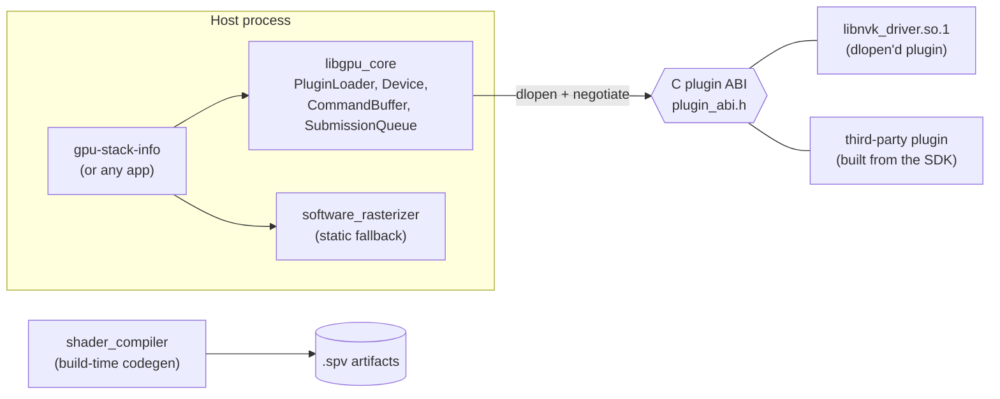
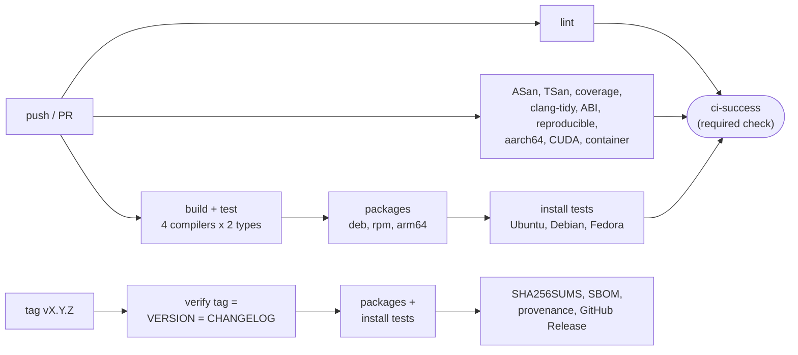

# gpu_driver_stack: build, release and CI/CD engineering for a GPU driver stack

[](https://github.com/7shantanu7/CICD/actions/workflows/ci.yml)
[](https://github.com/7shantanu7/CICD/actions/workflows/nightly.yml)

A modular C++ project shaped like a GPU driver stack, inspired by
**NVK** (Mesa's open-source Vulkan driver for NVIDIA hardware), with a build,
test, packaging and release pipeline that goes all the way from a commit to
signed, installable packages.

> **Scope note.** This is NVK-*inspired*, not real NVK. The driver code is a
> deliberately small mock. It exists so the build system, CI and release
> pipeline have something real to compile, test, package and ship. The skill
> on display is the build and release engineering, not the driver internals.

## What this project demonstrates

| Area | What is here | Where |
| --- | --- | --- |
| Modern CMake | Target-based modules, generated export and version headers, install and export rules, `find_package` support | `CMakeLists.txt`, `cmake/modules/` |
| One build interface | CMake presets for every flavour; CI calls presets, never raw flags | `CMakePresets.json` |
| ABI engineering | C plugin ABI with version negotiation, hidden symbols, linker version script, exported-symbol allow-list, libabigail gate | `core/include/gpu_core/plugin_abi.h`, `abi/`, `scripts/check_abi.sh` |
| Test depth | GoogleTest unit tests, broken-plugin tests, a C-only `dlopen` smoke test, a downstream consumer built against the installed SDK | `tests/` |
| Quality gates | 4 compilers x 2 build types, ASan+UBSan, TSan, coverage threshold, clang-tidy, clang-format, shellcheck, actionlint | `.github/workflows/ci.yml` |
| Packaging | `.deb` (with `-dbgsym`), `.rpm` (Fedora `lib64` layout), relocatable tarball, lintian clean, install-tested on clean Ubuntu, Debian and Fedora | `cmake/modules/Packaging.cmake`, `scripts/ci/install_test.sh` |
| Reproducibility | Same commit, two build directories, identical binaries and packages | `scripts/check_reproducible.sh` |
| Cross and GPU | aarch64 cross-build with tests under qemu; CUDA backend for several CUDA versions and GPU architectures, with a fat-binary check | `cmake/toolchains/`, `drivers/cuda/` |
| Release engineering | Tag-driven releases, changelog from commits, `SHA256SUMS`, SPDX SBOM, signed build provenance, release branches, automated backports | `.github/workflows/release.yml`, `docs/RELEASING.md` |
| Build infrastructure | Same pipeline on Jenkins and GitLab CI; autoscaling Kubernetes runners with a GPU pool; build metrics and regression tracking | `Jenkinsfile`, `.gitlab-ci.yml`, `infra/`, `tools/buildstats/` |

## Architecture



- **`libgpu_core`** defines the in-process C++ API: `Device`, `CommandBuffer`,
  `ShaderIR`, a thread-safe `SubmissionQueue`, and `LoadedPlugin`, which loads
  a driver plugin, negotiates the ABI version and validates its function table
  before calling it.
- **`nvk_driver`** is the NVK-inspired mock driver. It is a `dlopen()`-only
  module that exports exactly two C symbols. It depends on the ABI header
  only, never on `gpu_core`, the same way a Vulkan ICD depends only on the
  loader interface.
- **`software_rasterizer`** is the statically linked CPU fallback, for
  machines where no plugin loads.
- **`shader_compiler`** is a mock GLSL to SPIR-V tool. The build compiles it
  first and then runs it to generate `.spv` artifacts (`add_custom_command`).
- **`cuda_compute`** (optional) is a small CUDA backend, used to show how GPU
  code is built and checked in CI on runners without a GPU.

Why a C ABI, why version negotiation, and the other main decisions are
recorded in [docs/adr/](docs/adr/). For the pipeline design, see
[docs/ARCHITECTURE.md](docs/ARCHITECTURE.md).

## Quick start

Requirements: CMake 3.25 or later, Ninja, and GCC 12+ or Clang 16+. ccache is
used automatically if it is installed. GoogleTest is taken from the system if
installed (`libgtest-dev`); otherwise a hash-pinned archive is downloaded.

```bash
cmake --workflow --preset dev
```

That one command configures, builds and runs every test. To see all build
flavours:

```bash
cmake --list-presets=all
```

Common presets:

| Preset | Purpose |
| --- | --- |
| `dev` | Debug build for day-to-day work |
| `ci-debug`, `ci-release` | What CI runs; the compiler comes from `CC`/`CXX` |
| `asan`, `tsan` | AddressSanitizer + UBSan, ThreadSanitizer |
| `coverage` | gcov instrumentation for `gcovr` (gate in `gcovr.cfg`) |
| `tidy` | clang-tidy on every project target, warnings are errors |
| `abi` | Unstripped plugin build for the libabigail check |
| `release`, `release-rpm` | Packages (`.deb` + tarball, `.rpm`) |
| `cross-aarch64` | Arm64 cross-build; tests run under `qemu-aarch64` |
| `cuda` | CUDA backend (needs `nvcc`; architectures from `CUDA_ARCHS`) |

Examples:

```bash
CC=clang-18 CXX=clang++-18 cmake --workflow --preset tsan
```

```bash
CC=gcc CXX=g++ cmake --workflow --preset release && ls build/release/dist
```

```bash
GPU_STACK_DRIVERS=build/dev/drivers/nvk/libnvk_driver.so.1 build/dev/tools/gpu_stack_info/gpu-stack-info
```

The same toolchain is available as a container, which CI also tests:

```bash
docker build -f Dockerfile.dev -t gpu-stack-dev .
```

```bash
docker run --rm -v "$PWD:/workspace" -e CC=gcc-12 -e CXX=g++-12 gpu-stack-dev cmake --workflow --preset ci-release
```

## CI/CD pipeline



| Workflow | Trigger | What it does |
| --- | --- | --- |
| `ci.yml` | push, PR | Every gate above; one aggregated `ci-success` check for branch protection |
| `packages.yml` | called by CI, nightly and release | Builds every package and install-tests it on clean distributions |
| `release.yml` | tag `vX.Y.Z` / `vX.Y.Z-rc.N` | Verifies versions, packages, signs provenance, publishes the release |
| `nightly.yml` | daily | 25-run flaky-test hunt, cold-build metrics compared with the previous night, nightly packages |
| `dev-image.yml` | `Dockerfile.dev` changes | Publishes the dev and CI image to GHCR |
| `backport.yml` | label `backport release/X.y` | Opens a cherry-pick PR to the release branch |
| `pr-title.yml` | PR | Enforces Conventional Commit titles, which feed the changelog |
| `gpu-tests.yml` | manual | Runs CUDA tests on a real GPU via the self-hosted `arc-gpu` pool |

All pipeline logic lives in `scripts/ci/`. GitHub Actions, the `Jenkinsfile`
and `.gitlab-ci.yml` are thin wrappers around the same scripts and presets,
so moving to another CI system is cheap. That property matters in companies
that run their own build farms.

## Using an installed release

Install the packages from a release, then use it from CMake:

```cmake
find_package(gpu_driver_stack 1.0 REQUIRED CONFIG)
target_link_libraries(my_app PRIVATE gpu_driver_stack::gpu_core)
```

```bash
gpu-stack-info --require-plugin
```

Writing a driver plugin needs only the C header: link
`gpu_driver_stack::plugin_abi` and export the two entry points. A complete
example is in `tests/consumer/src/third_party_plugin.c`.

Every release can be verified:

```bash
sha256sum --check --ignore-missing SHA256SUMS
```

```bash
gh attestation verify gpu-driver-stack_1.0.0-1_amd64.deb --repo 7shantanu7/CICD
```

## Repository layout

```text
.
├── VERSION                 # the single source of the release version
├── CMakeLists.txt          # top level: options, global policy, subdirectories
├── CMakePresets.json       # every build flavour, used by humans and CI alike
├── core/                   # libgpu_core + the C plugin ABI header
├── drivers/
│   ├── nvk/                # NVK-inspired plugin, version script, symbol allow-list
│   ├── software/           # static CPU fallback
│   └── cuda/               # optional CUDA backend
├── shader_compiler/        # mock GLSL -> SPIR-V tool + build-time codegen
├── tools/
│   ├── gpu_stack_info/     # host tool shipped in the runtime package
│   └── buildstats/         # Python build/test metrics tool (+ unit tests)
├── tests/                  # unit, plugin, ABI, install and consumer tests
├── abi/                    # reviewed libabigail ABI baseline
├── cmake/                  # modules (warnings, sanitizers, packaging, ...) + toolchains
├── packaging/              # man pages and Debian changelog template
├── scripts/                # gates (ABI, symbols, format, reproducibility) and CI steps
├── infra/                  # local Jenkins, Kubernetes runner pools
├── docs/                   # architecture, release runbook, ADRs
├── Jenkinsfile, .gitlab-ci.yml, Dockerfile.dev
└── .github/                # workflows, Dependabot, CODEOWNERS, PR template
```

## Documentation

- [docs/ARCHITECTURE.md](docs/ARCHITECTURE.md): how the build and pipeline
  fit together
- [docs/RELEASING.md](docs/RELEASING.md): release runbook (RCs, release
  branches, backports, hotfixes, yanking a bad release)
- [docs/BUILD_CACHE.md](docs/BUILD_CACHE.md): ccache locally and in CI,
  sccache with a shared remote cache
- [docs/adr/](docs/adr/): architecture decision records
- [CONTRIBUTING.md](CONTRIBUTING.md), [SECURITY.md](SECURITY.md),
  [CHANGELOG.md](CHANGELOG.md), [RETROSPECTIVE.md](RETROSPECTIVE.md)
