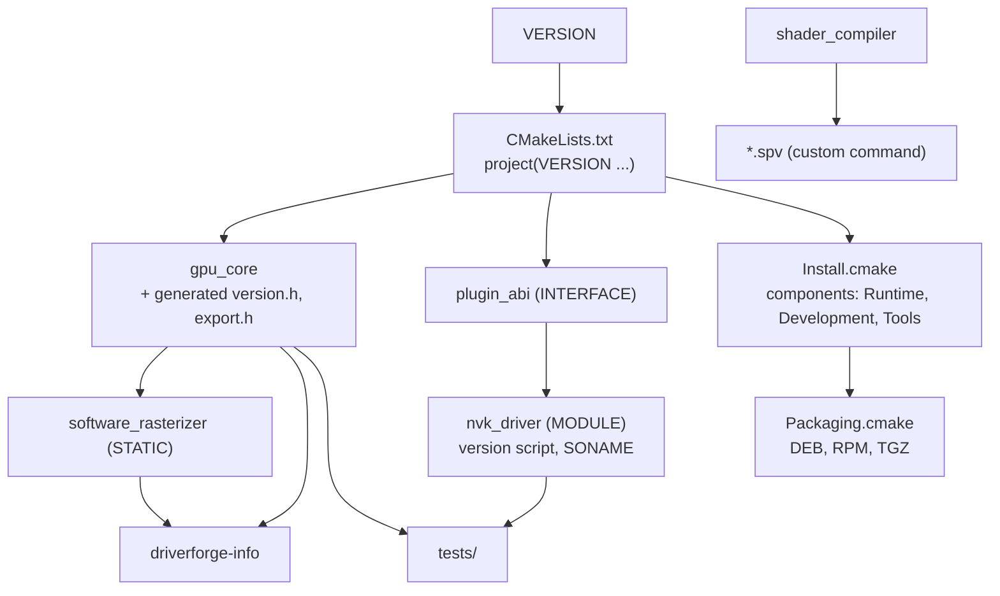
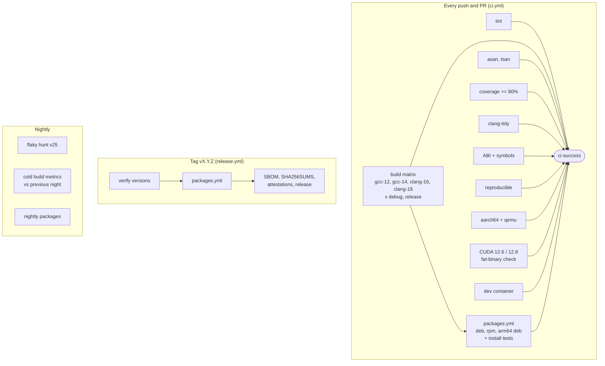

# Architecture: build system and pipeline

This page explains how the pieces fit together and why. The individual
decisions are recorded as ADRs in [adr/](adr/).

## Principles

1. **One source of truth per fact.** The release version is in `VERSION`.
   The plugin ABI version is in `plugin_abi.h` and `DRIVERFORGE_PLUGIN_SOVERSION`.
   Package names are set once in `CMakeLists.txt`. Build flavours are
   defined once in `CMakePresets.json`.
2. **CI is a thin wrapper.** Every CI system calls `scripts/ci/*.sh` and
   CMake presets. No build logic lives in YAML or Groovy, so any job can be
   reproduced locally with one command.
3. **Test what you ship.** Packages are installed on clean distributions and
   used there. The SDK is consumed by a separate downstream project. The
   plugin is loaded from plain C. Nothing is tested only through the
   build tree.
4. **Make breakage loud and early.** ABI changes, leaked symbols,
   non-reproducible output, data races, coverage drops and build-time growth
   each have an automated gate.

## Build graph

Key build-system techniques:

| Technique | Why |
| --- | --- |
| `CMAKE_CXX_VISIBILITY_PRESET hidden` plus `generate_export_header` | Only annotated classes become public ABI of `gpu_core` |
| Linker version script for the plugin | The plugin exports exactly two symbols; enforced by a test |
| `-Wl,-z,defs` on the plugin | A plugin with unresolved symbols fails at link time, not at `dlopen` time |
| `BUILD_INTERFACE` / `INSTALL_INTERFACE` | One target definition works from the build tree and from an installed package |
| `SameMajorVersion` package version file | `find_package(driverforge 1.0)` accepts 1.x and refuses 2.0 |
| Separate export set for tools | The `-dev` package never references a binary only `-tools` installs |
| `$ORIGIN`-relative RPATH and plugin path | The tarball can be unpacked anywhere and still finds its plugin |
| `-ffile-prefix-map` + `SOURCE_DATE_EPOCH` | Bit-for-bit reproducible binaries and packages |
| `FetchContent` with `URL_HASH` and `FIND_PACKAGE_ARGS` | GoogleTest is hash-pinned, and an installed copy is preferred, so offline builds work |
| Per-language generator expressions on global flags | Hardening, sanitizer and coverage flags never reach `nvcc` |

## Test layers

| Layer | Example | Proves |
| --- | --- | --- |
| Unit | `core_tests`, `shader_compiler_tests` | Behaviour of each module |
| Concurrency | `SubmissionQueueTest.ConcurrentProducersLoseNothing` under TSan | No data races in the queue |
| Error paths | `test_plugin_{future_abi,missing_symbol,null_table}` | The loader rejects bad plugins cleanly |
| ABI | `CAbiHeaderCompilesAsC`, `NvkDriverExportedSymbols`, libabigail job | The C ABI is valid C, minimal and stable |
| Integration | `NvkDriverPluginSmokeTest`, `DriverforgeInfo*` | The real plugin loads from C and from the host tool |
| Install | `InstallForConsumerTest` + `DownstreamConsumerBuild` | The installed SDK is consumable with `find_package` |
| Package | `scripts/ci/install_test.sh` on Ubuntu, Debian, Fedora | Packages install and work on clean systems |
| Codegen | `ShaderArtifactsGenerated` | The build-time code generation step really ran |
| Tooling | `BuildstatsPythonTests` | The metrics tool itself is correct |

## Pipeline

Caching rules: only pushes to `main` and `release/**` write the ccache and
Docker layer caches. Pull requests read them. A PR therefore cannot poison
a cache that other builds trust, and caches do not grow without bound.

## Supported platforms

| Platform | How it is covered |
| --- | --- |
| Ubuntu 24.04 x86_64 | Native build matrix, `.deb` install test |
| Debian 13 (trixie) x86_64 | `.deb` install test |
| Fedora 43 x86_64 | `.rpm` (`lib64` layout) install test |
| Linux aarch64 | Cross-build, full test suite under `qemu-aarch64`, arm64 `.deb` |
| CUDA 12.6 and 12.8 | Build-only in `nvidia/cuda` containers; real GPU runs via `gpu-tests.yml` |

Packages are built on Ubuntu 24.04, so they need glibc 2.34 or later and a
`libstdc++` from GCC 13 or later. Older distributions (for example Debian 12
or RHEL 9) would need a build on that distribution or an older toolchain
image; the install-test matrix is where that support would be proven.
